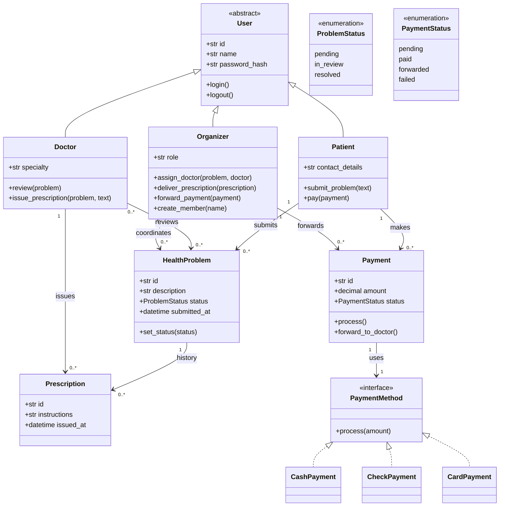
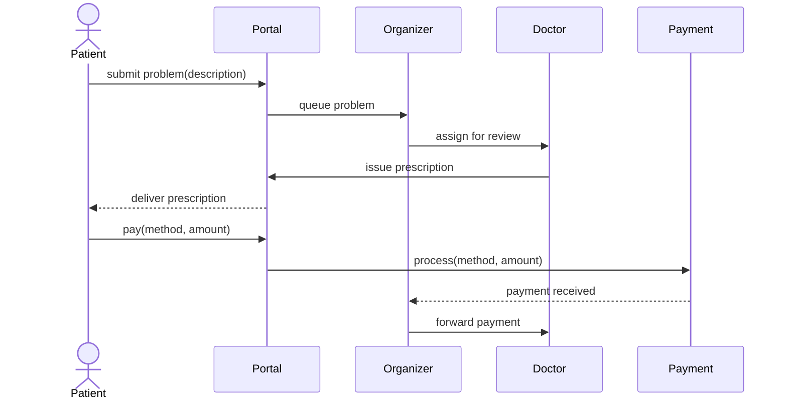
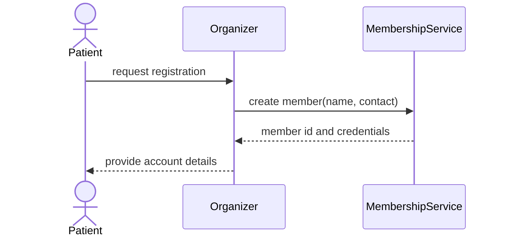
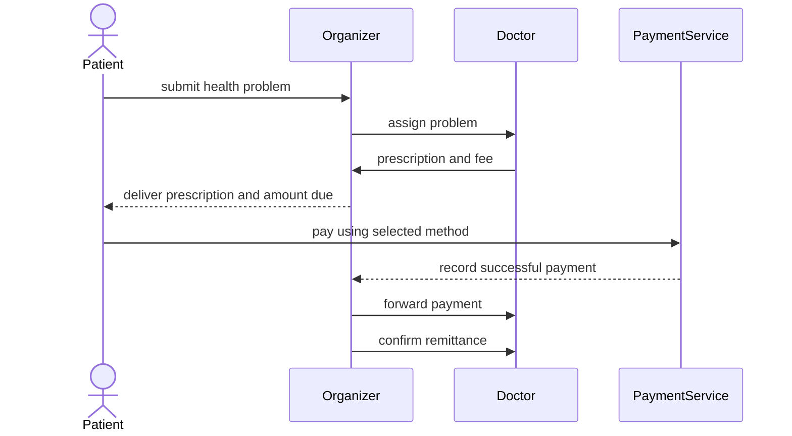
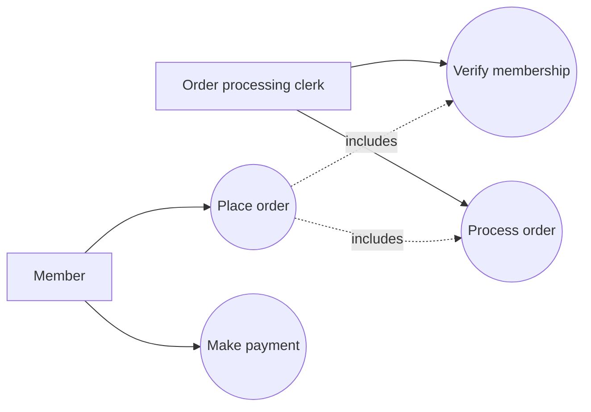
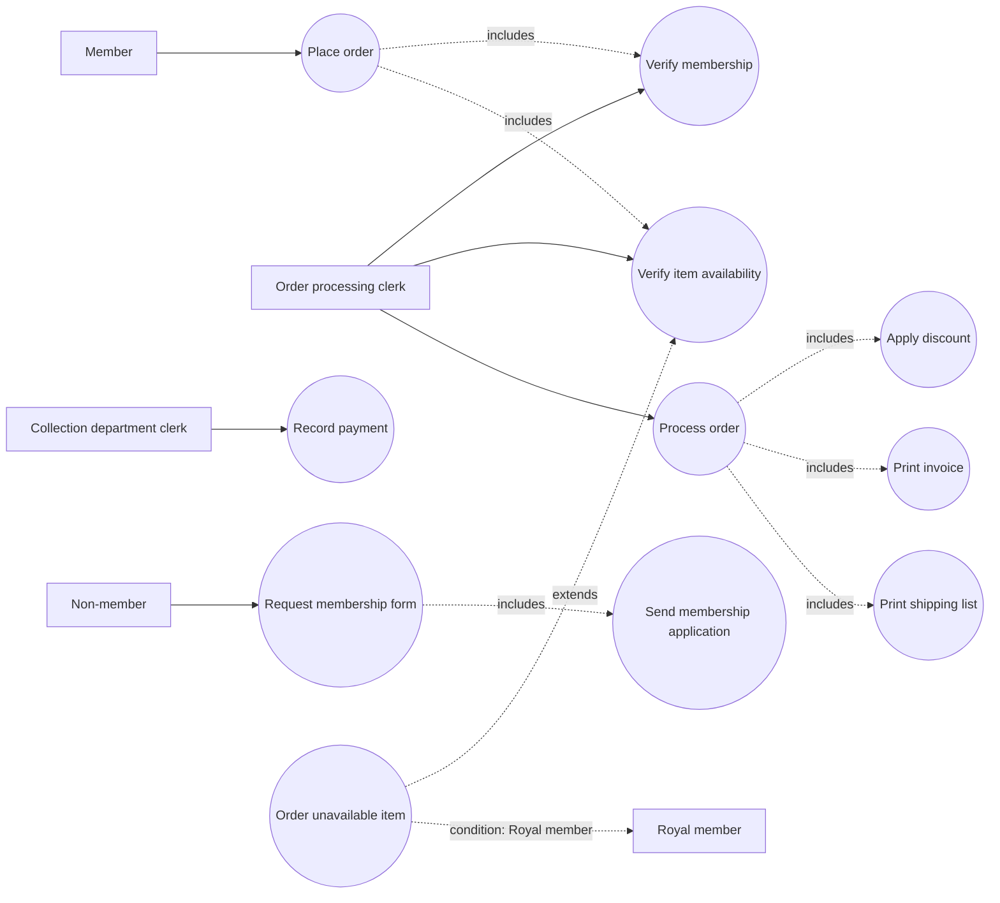
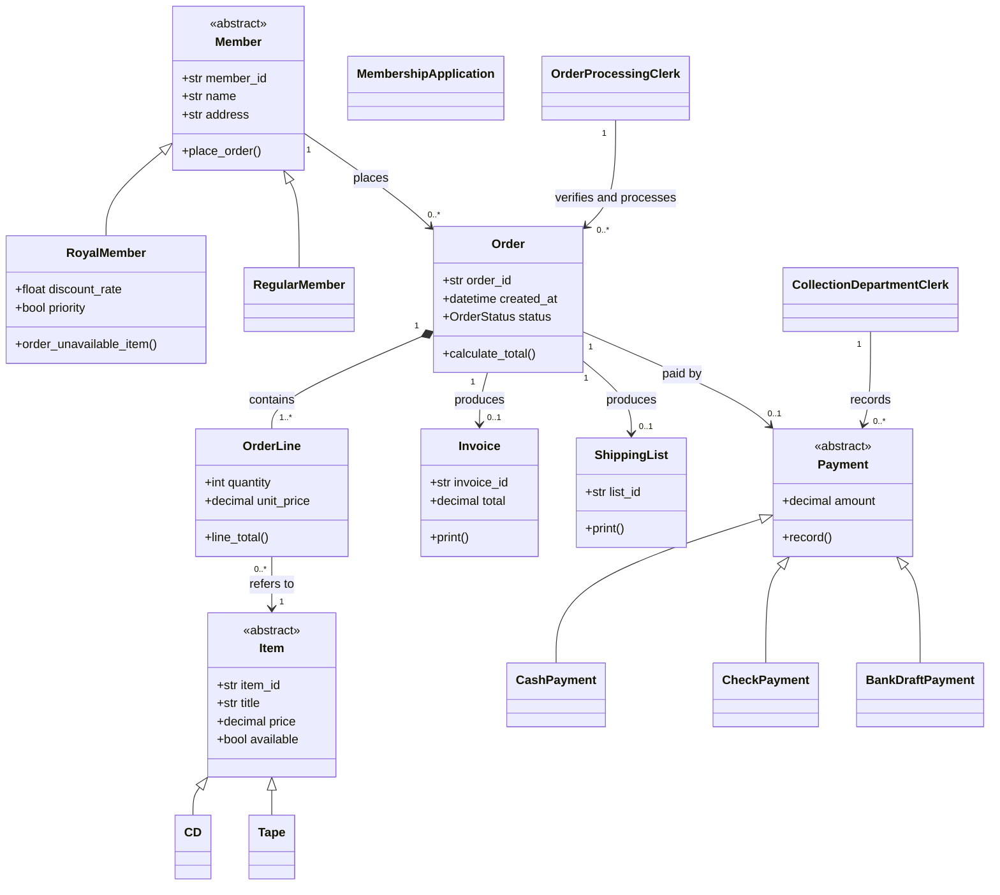
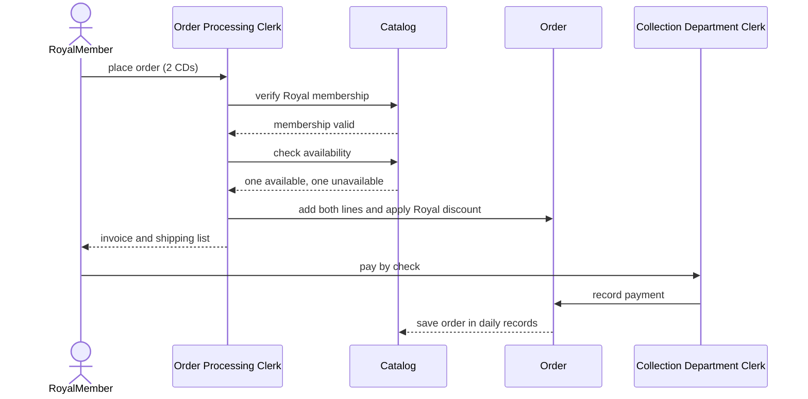
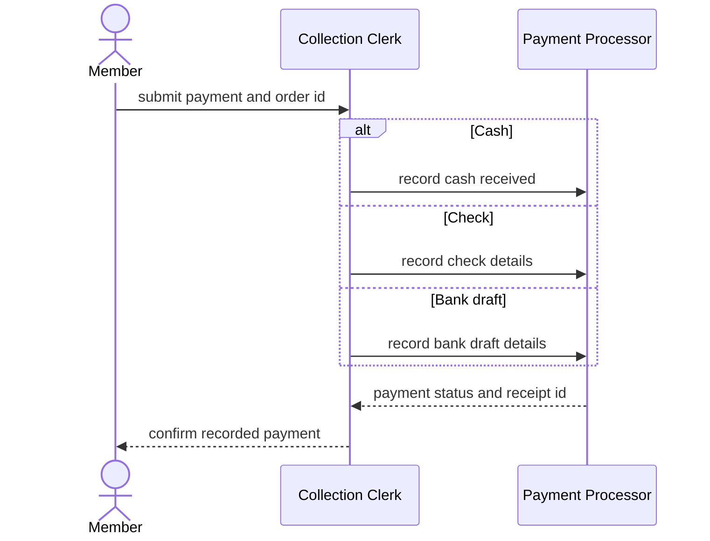

# UML diagrams

## Exercise 1 — Hospital Management System

### Class diagram, developed model



`ProblemStatus` has `pending`, `in_review`, and `resolved`; `PaymentStatus` has `pending`, `paid`, `forwarded`, and `failed`. Multiple doctors can review a problem. A prescription is a dated record linked to its problem, so older prescriptions remain available. A payment method handles the method-specific payment operation.

### Patient submits a problem, receives a prescription, and pays



### Registration



### Consultation and payment processing



### Data integrity notes

- Give every payment a unique idempotency key; retrying a request must not charge twice.
- Record payment state transitions transactionally (`pending` → `paid` → `forwarded`) and keep an audit trail.
- Mark the patient payment as successful only after the chosen method confirms it; record failed attempts separately.
- Treat forwarding as a separate, reconcilable transaction linked to the patient payment.

The payment strategy interface is the Strategy pattern: each cash, check, or card method provides the same `process(amount)` contract.

## Exercise 2 — ABCD Records

### Use-case diagram, core level



### Full use-case diagram



The unavailable-item extension is permitted only for Royal members. `Place order` and `process order` are shown separately to make membership and fulfillment responsibilities clear.

### Class diagram



### Order processing: Royal member, two CDs, one unavailable, pays by check



### Membership verification: success and failure

```mermaid
sequenceDiagram
    actor Clerk
    participant Membership as Membership Registry
    Clerk->>Membership: verify(member id)
    alt valid member
        Membership-->>Clerk: active; tier=Royal or Regular
        Clerk->>Clerk: continue order processing
    else unknown or inactive member
        Membership-->>Clerk: verification failed
        Clerk-->>Clerk: reject order and explain reason
    end
```

### Payment processing by type



### Reorder unavailable item for Royal member

```mermaid
sequenceDiagram
    actor RoyalMember
    participant Clerk as Order Processing Clerk
    participant Catalog
    participant Order
    RoyalMember->>Clerk: request unavailable item
    Clerk->>Catalog: verify Royal tier and item status
    Catalog-->>Clerk: Royal tier confirmed; item unavailable
    Clerk->>Order: add backorder line
    Order-->>RoyalMember: confirm backorder and expected follow-up
    Clerk->>Catalog: save order in daily records
```

### Assumptions

- Each order has one member and at least one order line; a member may place many orders.
- A Royal discount is calculated during order processing. The business must define whether discounts apply to shipping; this model assumes item subtotals only.
- A daily record is an order repository/audit record, not a separate UML entity in the first class diagram.
- A Royal unavailable-item request is a backorder; stock reservation and delivery timing are outside this exercise's stated scope.
