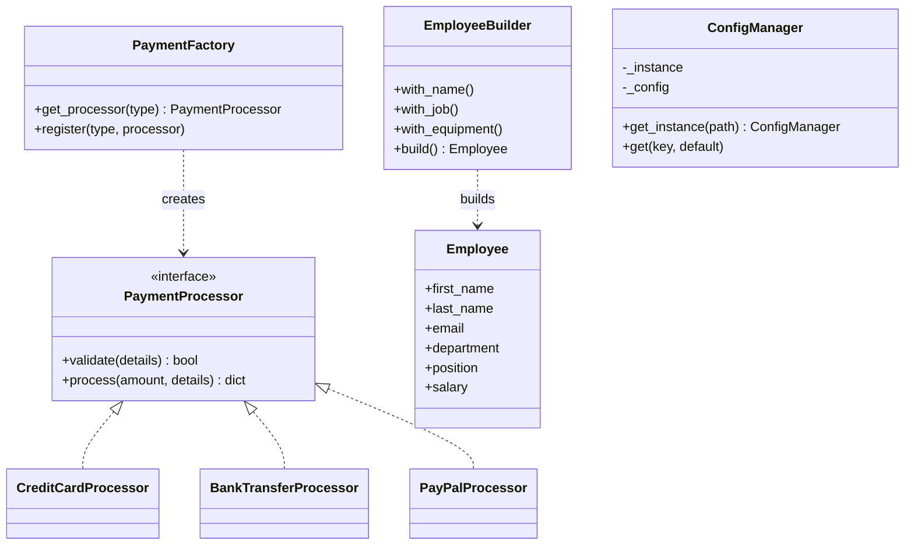
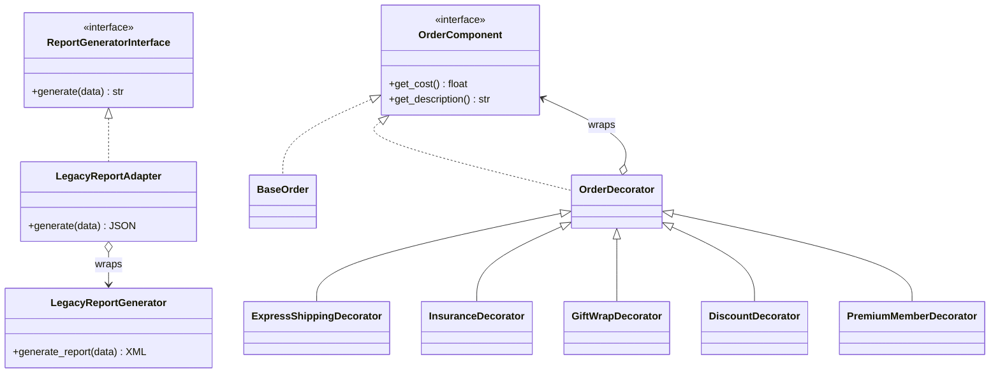
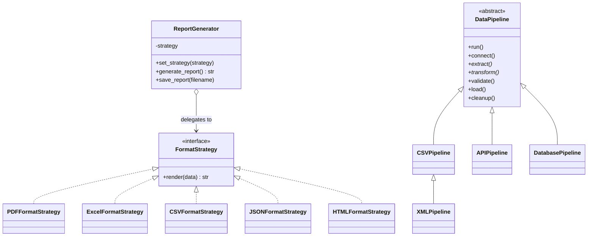

# Design-pattern class diagrams

The three course pages form one assignment. The diagrams below show the example classes and pattern relationships.

## Creational patterns

## Structural patterns

## Behavioral patterns

In the Template Method example, `run()` owns the fixed step order. Concrete pipelines override extraction and transformation while the base class shares validation, loading, and cleanup.
